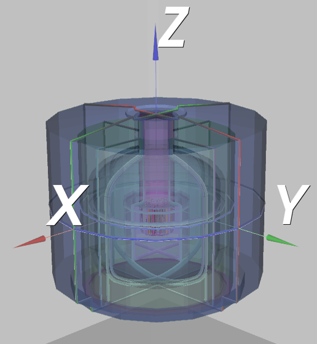
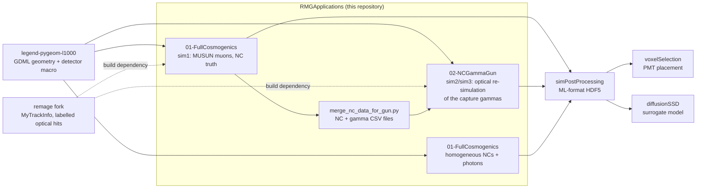

# RMGApplications

Geant4 Monte Carlo applications, built on [remage](https://github.com/legend-exp/remage), that simulate
neutron captures (NCs) induced by cosmic muons in the water tank of LEGEND-1000 and the optical photons
of their gamma cascades. The photons are recorded on a sensitive surface detector (SSD) that covers the
inner tank surfaces, or on explicit PMT layouts. The output is the simulation input of the PMT placement
optimisation of the neutron tagger, the photomultiplier system of the water tank.

This repository is part of my master's thesis *"Optimisation of the LEGEND-1000 Neutron Tagger Using a
Surrogate Monte Carlo Simulation"* (Eberhard Karls Universität Tübingen). It is a fork of
[EricMEsch/RMGApplications](https://github.com/EricMEsch/RMGApplications); see
[Upstream and contributions](#upstream-and-contributions).

## Background

<sup>77</sup>Ge, produced when cosmic-muon-induced neutrons are captured on <sup>76</sup>Ge, is a
background for the neutrinoless double-beta decay search of LEGEND-1000. Muons that produce
<sup>77</sup>Ge can be tagged by detecting the light of the neutron captures that follow the muon. For
the PMT placement, simulated NCs are described by their truth (muon, position, time, gamma cascade,
<sup>77</sup>Ge flag) and by the light they produce on the SSD. The applications simulate both, and
every optical photon carries the IDs of the capture that produced it.

**All geometries (GDML files) in this repository are preliminary**, and so is the figure below.

<p align="center">
  
</p>

*Preliminary geometry of the LEGEND-1000 water tank with the coordinate axes x (red), y (green) and
z (blue).*

## Where this repository fits



## Framework

- **remage v0.2.0**, used through the fork
  [UniThommi/remage, branch `sim/OptPhotonsPrismaSensitiveSurface`](https://github.com/UniThommi/remage/tree/sim/OptPhotonsPrismaSensitiveSurface).
  The branch leaves upstream remage at commit `18b4fba` (November 2024, version 0.2.0). Both
  applications only build against this fork, because it provides `MyTrackInfo`, the track label that
  the applications attach to every particle.
- **Geant4 v11.3.0**, the version used for the thesis.

## Upstream and contributions

The repository was started by Eric Esch as a collection of remage applications
([EricMEsch/RMGApplications](https://github.com/EricMEsch/RMGApplications), commits from August 2024 to
January 2025). The branch `master` holds the upstream state of December 2024. Everything listed below
under *my contributions* was added on the branch `NeutronCapturesMUSUN` from January 2025 onwards.

**From the upstream repository, unchanged:** `CosmogenicPhysics` and `RNGCerenkov`/`RNGTrackingAction`
(optical physics with a separate random-number engine for optical photons, only active with `-r`),
`CLI11.hpp`, the PMT quantum-efficiency datasheet `R7081_QEWhitespace.csv`, the example muon file
`MUSUN_100_events.csv`, `docs/Rerun.md`, the geometries `gdml/L1000V0.gdml` and
`gdml/WLGDOptical.gdml`, and the basic structure of `01-FullCosmogenics` (`main.cc`, `run.mac`,
`CMakeLists.txt`). `02-NCGammaGun` contains identical copies of these classes and files. Upstream
applications and components that were removed on this branch (`02-TestIsotopeFilter`,
`03-TestNeutronCapture`, `04-TestDistance`, the custom isotope filter, MUSUN generator, QE override,
`CosmogenicOutputScheme` and the seed-restoration scripts) are available in the upstream repository.

**My contributions:**

- *NC truth in `01-FullCosmogenics`:* `MySteppingAction` records every primary neutron capture with its
  position, time, volume, material, all capture gammas and the <sup>77</sup>Ge flag, and labels all
  particles that descend from it with (muon ID, NC ID, gamma ID). Two output schemes write the NCs
  (`MyNeutronCaptureOutputScheme`) and all their gammas (`MyGammaCaptureOutputScheme`). Command-line
  options `-g` (geometry), `-o` (output directory) and `-s` (NC recording); macros for the MUSUN, the
  homogeneous-NC and the interactive optical-test simulations; the remage Grabmayr gamma cascades
  activated, with an added ²H cascade table for captures on hydrogen.
- *`02-NCGammaGun`:* the complete application. Two generators re-shoot the capture gammas of the MUSUN
  simulation, one NC per event or one muon with all its NCs per event, from CSV files shared by all
  threads; a primary-vertex label and a debug output scheme for the vertex labels; the merge script
  `merge_nc_data_for_gun.py`; notebooks that validate the event structure of both generators.
- *remage fork:* `MyTrackInfo`, and optical hits that additionally store the photon position, momentum
  direction and the muon, NC and gamma IDs of the label. Not mine on that branch: the backported newer
  upstream version of `RMGVertexConfinement` and the generated version files.
- *Tools and geometry:* `calculateSSDReflectivity.py`, `visGdml.py`, the notebook
  `analyze_unique_NCs.ipynb`, and the generated SSD, PMT and test geometries with their detector macros
  in `gdml/` (apart from the two upstream geometries).

## Branches

| Branch | Content |
|---|---|
| `NeutronCapturesMUSUN` | the work described here; contains all other branches |
| `master` | upstream state of Eric Esch's repository (December 2024) |
| `RESuMnC`, `test/tyvekWall` | earlier stages of `NeutronCapturesMUSUN` (March 2025, February 2026) |

The remage fork is a separate repository; its relevant branch is `sim/OptPhotonsPrismaSensitiveSurface`.

## Simulation workflow

1. **MUSUN simulation (sim1, `01-FullCosmogenics`).** Cosmic muons from a MUSUN file are simulated
   without optical physics. Each event contains one muon, so the Geant4 event ID serves as muon ID. For
   every primary NC, the output contains one row in `MyNeutronCaptureOutput` and one row per gamma in
   `CaptureGammas`. Neutrons that descend from an already recorded capture carry its label and are not
   recorded again.
2. **Merging (`merge_nc_data_for_gun.py`).** The NC and gamma tables of all runs are merged into
   `merged_ncs.csv` and `merged_gammas.csv`. Event IDs start at 0 in every run, so colliding muon IDs
   are re-indexed; run ID and original muon ID are kept. `--ge77-only` keeps only muons with at least
   one <sup>77</sup>Ge-producing NC.
3. **Optical re-simulation (sim2, `02-NCGammaGun`).** The capture gammas are shot again from the
   capture position and time, now with optical physics, in the SSD geometry or in a geometry with PMTs.
   The thesis simulations shoot the gammas of one NC per event (`--generator single`). Each optical hit
   carries the muon, NC and gamma IDs, which link it to the NC truth of sim1. Repeated runs on the same
   CSV files (sim3) are summed in simPostProcessing.
4. **Homogeneous NCs (`01-FullCosmogenics`).** For the training data of the diffusion model, neutrons
   are distributed homogeneously in a cylinder (commented block in `run.mac`), with optical physics and
   `-s`, so the NC truth and the optical photons are written to the same file.

simPostProcessing assigns the photons to the NCs and the SSD voxels and turns the raw output into the
ML-ready datasets.

## Repository structure

```
RMGApplications/
├── 01-FullCosmogenics/      MUSUN and homogeneous-NC simulations (NC truth)
│   ├── main.cc              command-line options, registration of the NC recording (-s)
│   ├── src/, include/       stepping action, NC and capture-gamma output schemes, upstream physics
│   ├── run.mac              MUSUN simulation; homogeneous-NC generator as commented block
│   ├── interactive.mac      OpenGL view of optical photons on the wall test geometry
│   ├── GrabmayrGammaCascades/  ²H cascade table (the Gd tables are not included)
│   ├── analyze_unique_NCs.ipynb  counts the unique (event, NC) pairs in the output
│   ├── scene_l1000.json     viewer scene with NC positions and hit vertices (local paths)
│   └── debugging/           gdb inside the remage Apptainer image
├── 02-NCGammaGun/           optical re-simulation of the capture gammas
│   ├── main.cc              command-line options, generator selection (--generator)
│   ├── src/, include/       gamma generators, vertex label, debug output scheme, stepping action
│   ├── run.mac              optical simulation with the gamma generator
│   ├── merge_nc_data_for_gun.py   sim1 HDF5 output -> CSV input of the generators
│   └── check*GammaGunConsistency.ipynb  validation of the event structure of both generators
├── gdml/                    preliminary geometries and detector macros (see below)
├── docs/                    figure used in this README
├── calculateSSDReflectivity.py  SSD reflectivity table for a given PMT area fraction
├── visGdml.py               3D view of a GDML file with pyg4ometry
├── local_paths.py           machine-specific root directories from local_paths.json
└── local_paths.example.json format of the git-ignored local_paths.json
```

`gdml/` contains the SSD detector geometry `currentDistZylSSD300PMTs.gdml` and the geometry with 300
PMTs `currentDistZylPMT300PMTs.gdml` with their detector macros, and three subdirectories. All of these
geometries are preliminary.

- `optimizedPMTs/`: simulated PMT layouts; the file names follow the options of voxelSelection (e.g.
  `NcM1m1`, `MuonM1m1W6`, `UniformW2_*`, `Worst`),
- `testOptimalWallDistance/`: PMT setups with different pit and wall distances,
- `testSSD/`: the wall and sphere test geometries of efficiencyDerivationSSD (in water and in vacuum).

## Setup

Requirements:

- the remage fork (branch `sim/OptPhotonsPrismaSensitiveSurface`), built and installed so that CMake
  finds it (`find_package(remage REQUIRED COMPONENTS GDML)`), with Geant4 v11.3.0,
- CMake ≥ 3.8,
- Python 3 with h5py, numpy and tqdm for the merge script; pandas and matplotlib for the notebooks;
  pyg4ometry for `visGdml.py`.

Build each application separately:

```sh
cd 01-FullCosmogenics    # or 02-NCGammaGun
mkdir build && cd build
cmake ..
make
cd ..
```

Both applications build an executable named `FullCosmogenics`.

**Not included in the repository:** the MUSUN muon file `musun/combined_file.dat` and the Gd cascade
tables `GrabmayrGammaCascades/156Gd-5keV-cascades.txt` and `158Gd-5keV-cascades.txt`. The macros load
these files and the detector macro `./gdml/macroZylSSD.mac` relative to the working directory (the
application folder); the geometry files are stored in the top-level `gdml/` directory, so they have to
be reachable as `./gdml` from the application folder.

The notebooks and the debugging scripts read machine-specific root directories from a git-ignored
`local_paths.json` in the repository root (format: `local_paths.example.json`).

## Usage

All commands are run from the application folder; `--help` lists all options.

```sh
# sim1: MUSUN muons with NC recording (-s is required by run.mac)
./build/FullCosmogenics -m run.mac -g gdml/currentDistZylSSD300PMTs.gdml -t 256 -o ./build/ -s

# merge the NC output of several runs (run_NNN/output_t*.hdf5)
python merge_nc_data_for_gun.py -i /path/to/sim1 -o /path/to/merged --nested [--ge77-only]

# sim2: optical re-simulation, one NC per event (used for the thesis; --generator muon: one muon per event)
./build/FullCosmogenics -m run.mac -g gdml/currentDistZylSSD300PMTs.gdml --generator single -o ./build/
```

Options of both applications: `-m` macro (required), `-g` GDML file (required), `-t` threads
(default 256), `-o` output directory (default `./build/`), `-r` RNG mode of the upstream code (0 off,
1 pre-run, 2 restoration; writes to fixed file names in `build/`). `01-FullCosmogenics` has `-s` (NC
recording); `02-NCGammaGun` requires `--generator single|muon`.

In `02-NCGammaGun/run.mac`, the directory of the merged CSV files is set with
`/My/Generator/SingleNCGamma/SetMergedDir` (or `/My/Generator/MuonGamma/SetMergedDir` with
`--generator muon`). `/run/beamOn` should not exceed the number of NCs (single) or muons (muon); further
events get no primaries.

Tools:

```sh
python calculateSSDReflectivity.py 1/5     # R_SSD(λ) for a PMT cathode area fraction of 1/5
python visGdml.py gdml/currentDistZylSSD300PMTs.gdml
```

## Output

remage writes one HDF5 file per worker thread (`output_t<N>.hdf5`); the tables are under `hit/`.

| Table | Application | Content |
|---|---|---|
| `MyNeutronCaptureOutput` | 01 (`-s`) | one row per primary NC: event ID, NC track ID, position (m), time (ns), volume and material ID, gamma multiplicity and total energy (keV), <sup>77</sup>Ge flag, direction and energy of the four most energetic gammas |
| `CaptureGammas` | 01 (`-s`) | one row per capture gamma: event ID, NC ID, gamma ID, direction, energy (keV), polarisation |
| `physVolumes`, `materials` | 01 (`-s`) | mapping of the volume and material IDs to names (valid within one file) |
| `optical` | 01 and 02 with optical physics | optical hits; the remage fork adds position, momentum direction, `muon_track_id`, `nC_track_id`, `gamma_track_id` |
| `DebugVertices` | 02 | label (muon, NC, gamma ID) of every primary vertex |

## Known limitation

In `02-NCGammaGun`, `MySteppingAction` labels every primary gamma with the IDs of vertex 0 of the event
instead of those of its own vertex. With `--generator single` all vertices of an event belong to one NC,
so muon and NC IDs are correct, but all photons of the event carry the gamma ID of the first gamma. With
`--generator muon` the vertices of an event belong to different NCs of the same muon, so photons of
later NCs would carry the NC ID of the first one.

The thesis simulations use `--generator single` only; the muon generator is included for completeness.
The downstream tools assign photons by muon and NC ID and do not use the gamma ID of the optical hits.

## Related repositories

- [UniThommi/remage](https://github.com/UniThommi/remage/tree/sim/OptPhotonsPrismaSensitiveSurface):
  remage fork required to build the applications
- [EricMEsch/RMGApplications](https://github.com/EricMEsch/RMGApplications): upstream repository
- [legend-pygeom-l1000](https://github.com/UniThommi/legend-pygeom-l1000): LEGEND-1000 geometry; the
  detector macro of the SSD geometry was created with it
- [simPostProcessing](https://github.com/UniThommi/simPostProcessing): conversion of the simulation
  output into the ML-format HDF5
- [voxelSelection](https://github.com/UniThommi/voxelSelection): PMT placement on the SSD voxels and
  evaluation of the simulated PMT setups
- [efficiencyDerivationSSD](https://github.com/UniThommi/efficiencyDerivationSSD): validation of the SSD
  reflectivity with the test geometries in `gdml/testSSD/`
- [diffusionSSD](https://github.com/UniThommi/diffusionSSD): diffusion model trained on the
  homogeneous-NC data

---

Thomas Bürger, Eberhard Karls Universität Tübingen
